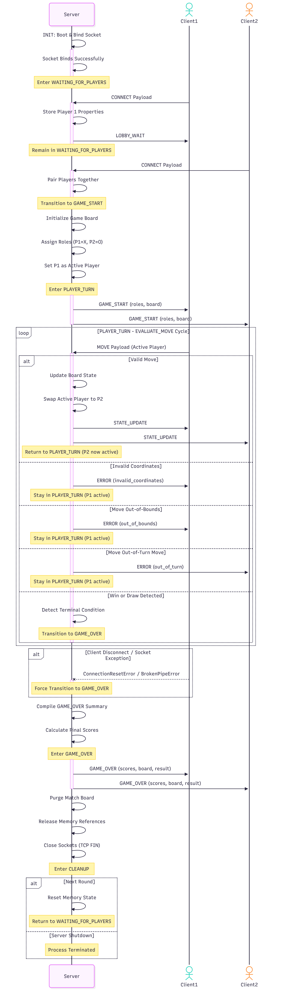

### Concurrency Architecture Document
* **Concurrency Model:** The Concurrency Model Being used will be Multi-threading. Each clients connection socket will have its own dedicated worker thread made to communicate to and from the server.
* **Connection Lifecycle**:The server manages client connections through five different stages:

[1. `Listening Socket Accept`] -> [2. `Client Registration`] -> [3. `Active Game Loop`] -> [4. `Socket Teardown`] -> [5. `Memory Cleanup`]

1. **Listening Socket Accept:** The main thread binds to the host IP and port, establishing a fresh socket for the client. It enters a loop executing `socket.accept()`. This call blocks until an incoming client attempts to make a connection.
2. **Client Registration:** Once a socket connection is accepted, the main thread instantly hands the client socket descriptor over to a newly instantiated `threading.Thread()`. The thread is registered, named, and started (`thread.start()`), freeing the main thread to immediately return to its listening state for the next client.
3. **Active Game Loop Servicing:** The spawned worker thread enters a persistent communication loop. It reads from the socket, passes data to the validation layers, mutates the shared game board if the move is legal and data is from the active player, and then broadcasts resulting gamestate changes to both clients. 
4. **Client Socket Teardown:** If a client drops, sends a TCP FIN paylaod, or throws a socket exception (`ConnectionResetError`, `BrokenPipeError`), the loop breaks. The thread safely closes the socket descriptor via `socket.close()`.
5. **Resource and Memory Purge:** The worker thread removes its client references from the global list, deletes match references to prevent memory leaks, and terminates cleanly.

### Thread Safety Analysis and Lock Aquisition Stratagy:

* Because multiple independent player threads execute concurrently, any resource shared globally across threads represents a possibility for data corruption.

### Documented Shared Resources
* **Game Board Matrix:** A 7x6 nested list representation of the Connect Four grid accessed and mutated by both players.
* **Active Turn State:** A state flag tracking which player's turn it is (`active_player`).
* **Connected Client Socket List:** A global roster containing open socket references used to broadcast game events.
* **Round Scores** A tracking structure used to maintain cumulative wins, losses, and ties across multiple rounds.

### Preventative Lock Strategy & Critical Sections
* To eliminate race conditions (both players mutating the gameboard simultaneously, or a thread reading an incomplete state update), the server implements mutual exclusion using a single global `threading.Lock()` instance acting as a **Mutex**.

* Every operation that reads or writes to a shared resource is wrapped tightly inside a **Critical Section**. This guaranteeing that the lock is automatically released even if an unhandled runtime error occurs inside the critical section.

### State & Score Broadcase Sequence Diagram (Created with Mermaid)

sequenceDiagram
    participant Server
    actor Client1
    actor Client2

    Server->>Server: INIT: Boot & Bind Socket
    activate Server
    Server->>Server: Socket Binds Successfully
    Note over Server: Enter WAITING_FOR_PLAYERS
    deactivate Server

    Client1->>Server: CONNECT Payload
    activate Server
    Server->>Server: Store Player 1 Properties
    Server->>Client1: LOBBY_WAIT
    Note over Server: Remain in WAITING_FOR_PLAYERS
    deactivate Server

    Client2->>Server: CONNECT Payload
    activate Server
    Server->>Server: Pair Players Together
    Note over Server: Transition to GAME_START
    deactivate Server

    Server->>Server: Initialize Game Board
    Server->>Server: Assign Roles (P1=X, P2=O)
    Server->>Server: Set P1 as Active Player
    Note over Server: Enter PLAYER_TURN

    activate Server
    Server->>Client1: GAME_START (roles, board)
    Server->>Client2: GAME_START (roles, board)
    deactivate Server

    loop PLAYER_TURN - EVALUATE_MOVE Cycle
        Client1->>Server: MOVE Payload (Active Player)
        activate Server
        alt Valid Move
            Server->>Server: Update Board State
            Server->>Server: Swap Active Player to P2
            Server->>Client1: STATE_UPDATE
            Server->>Client2: STATE_UPDATE
            Note over Server: Return to PLAYER_TURN (P2 now active)
        else Invalid Coordinates
            Server->>Client1: ERROR (invalid_coordinates)
            Note over Server: Stay in PLAYER_TURN (P1 active)
        else Move Out-of-Bounds
            Server->>Client1: ERROR (out_of_bounds)
            Note over Server: Stay in PLAYER_TURN (P1 active)
        else Move Out-of-Turn Move
            Server->>Client2: ERROR (out_of_turn)
            Note over Server: Stay in PLAYER_TURN (P1 active)
        else Win or Draw Detected
            Server->>Server: Detect Terminal Condition
            Note over Server: Transition to GAME_OVER
        end
        deactivate Server
    end

    alt Client Disconnect / Socket Exception
        Client1--xServer: ConnectionResetError / BrokenPipeError
        activate Server
        Note over Server: Force Transition to GAME_OVER
        deactivate Server
    end

    Server->>Server: Compile GAME_OVER Summary
    Server->>Server: Calculate Final Scores
    Note over Server: Enter GAME_OVER

    activate Server
    Server->>Client1: GAME_OVER (scores, board, result)
    Server->>Client2: GAME_OVER (scores, board, result)
    deactivate Server

    Server->>Server: Purge Match Board
    Server->>Server: Release Memory References
    Server->>Server: Close Sockets (TCP FIN)
    Note over Server: Enter CLEANUP

    alt Next Round
        Server->>Server: Reset Memory State
        Note over Server: Return to WAITING_FOR_PLAYERS
    else Server Shutdown
        Note over Server: Process Terminated
    end